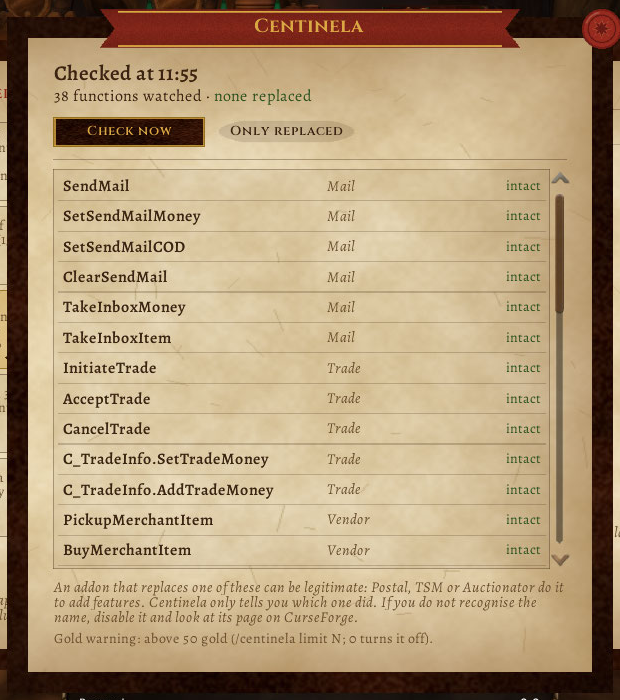

# Centinela

For **WoW Forever** players with many addons. Centinela watches the game functions that move gold and items (mail, trade, vendor, bank, auction house) and tells you whether an addon **replaced** any of them, and which one. It also asks before a large amount of gold leaves by mail or trade.

It accuses no one: it reports. Many good addons replace these functions to add features (Postal, TSM, Auctionator). Centinela only tells you who did it, so you can recognise it or not.

[Leer en castellano](README.md)

## How to use it

Open it with `/centinela`, the **round minimap button** (right click: check now; drag it around the minimap, `/centinela minimap off` hides it), the key binding or the addon compartment. The window is a **parchment page** (the [Pergamino](https://github.com/JoseArgento/pergamino) skin shared by Bitácora and the other addons): when it last checked, how many functions it watches and how many are replaced; the list, each function with what it does and whether it is **intact** or **replaced by** an addon ("Only replaced" filters); "Check now"; and at the foot what a replacement means and the gold limit.

It checks 5 seconds after login (so addons that load late count) and every 10 minutes. **In the chat** it only speaks when a replacement is **new** since last time.

- `/centinela` opens the page, `/centinela check` checks now.
- `/centinela limit 100` warns from 100 gold; `/centinela limit 0` turns the warning off. Default 50.
- `/centinela minimap on|off`, `/centinela idioma es|en|auto`.

## What it watches

38 functions, all checked against the Forever 1.60.1 API: mail, trade, vendor, bags and cursor, quest acceptance, guild and account bank, auction house, chat, settings and the game's confirmation popups. It uses the game's `issecurevariable`, which says whether a function is still Blizzard's and, if not, which addon overwrote it. An addon that only **hooks** a function (`hooksecurefunc`, what most do) does not replace it and shows as intact. Functions missing from the client are skipped.

## The gold warning

While the mail or trade window is open, Centinela reads the amount you typed. Above the limit, once per amount: "you are about to send 120 gold to Ana. Sure?". **No** clears the amount; **Yes** does nothing else. It is a **warning, not a lock**: it replaces no game function, and a money mail an addon sends without the window is noted in the chat afterwards.

## Tested

- ✅ Every function it uses and all 38 it watches exist in Forever 1.60.1 (`tools/check_api.py`); forever-lint clean; Addon Sentry "no risk signals"; **39 tests** in Lua 5.1.
- **In the client** (5 November): the check on login, the page with the 38 functions and the minimap button; with no addon replacing those functions, all came back "intact". ⏳ Not seen yet: `issecurevariable`'s second return when a function was replaced, and its table form in Forever; the names of the mail and trade money boxes; how the popup sits next to Forever's own secure transfer confirmation.

Not affiliated with Blizzard Entertainment. MIT licence.
