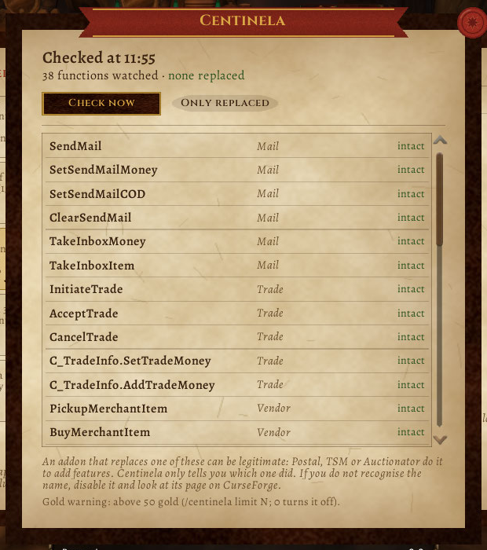

# Centinela

Para los que juegan **WoW Forever** con muchos addons. Centinela mira las funciones del juego que mueven oro y objetos (correo, comercio, vendedor, banco, subasta) y te dice si algún addon las **reemplazó**, y cuál. Además te pregunta antes de que salga mucho oro por correo o por comercio.

No acusa a nadie: informa. Muchos addons buenos reemplazan estas funciones para sumar cosas (Postal, TSM, Auctionator). Centinela solo te dice quién fue, para que lo reconozcas o no.

[Read in English](README.en.md)



**Contenido**

- [Cómo se usa](#cómo-se-usa)
- [Qué mira](#qué-mira)
- [El aviso de oro](#el-aviso-de-oro)
- [Instalar](#instalar)
- [Cómo se probó](#cómo-se-probó)
- [Desarrollo](#desarrollo)
- [Apoyar](#apoyar)

## Cómo se usa

Se abre con `/centinela`, con el **botón redondo del minimapa** (clic derecho: revisar ahora; se arrastra alrededor del minimapa y `/centinela minimapa off` lo esconde), con el atajo de teclado o desde el compartimento de addons. La ventana es una **página de pergamino** (la piel [Pergamino](https://github.com/JoseArgento/pergamino), la misma de Bitácora y los demás addons):

- Arriba: cuándo fue la última revisión, cuántas funciones vigila y cuántas están reemplazadas.
- La lista: cada función con lo que hace ("Correo", "Comercio"...) y si está **intacta** o **reemplazada por** tal addon. "Solo reemplazadas" filtra.
- "Revisar ahora" y, al pie, qué significa un reemplazo y el tope del aviso de oro.

Revisa sola a los 5 segundos de entrar (así cuenta a los addons que cargan tarde) y cada 10 minutos. **En el chat** te dice algo solo si hay un reemplazo **nuevo** desde la última vez (otro addon, o uno que antes no estaba): "Centinela: SendMail está reemplazada por AddonX (nuevo desde la última vez)". Si no cambió nada, no dice nada.

- `/centinela` abre la página, `/centinela revisar` revisa ahora.
- `/centinela tope 100` avisa a partir de 100 de oro; `/centinela tope 0` apaga el aviso. Por defecto, 50.
- `/centinela minimapa on|off` muestra o esconde el botón del minimapa.
- `/centinela idioma es|en|auto`: castellano, inglés o el del cliente (para los que juegan con el cliente en inglés).

## Qué mira

38 funciones, todas verificadas contra la API de Forever 1.60.1: el correo (`SendMail`, `SetSendMailMoney`, sacar oro y objetos del buzón), el comercio (`AcceptTrade`, `C_TradeInfo.SetTradeMoney`...), el vendedor (comprar, vender, recomprar), las bolsas y el cursor (agarrar oro, borrar objetos), aceptar misiones, el banco de la guild y el de cuenta, la casa de subastas (`C_AuctionHouse.PostItem`, `PlaceBid`...), escribir en el chat, cambiar ajustes y las ventanas de confirmación del juego.

Cómo: el juego tiene `issecurevariable`, que dice si una función sigue siendo la que puso Blizzard y, si no, qué addon la pisó. Un addon que solo se **engancha** a una función (`hooksecurefunc`, lo que hacen casi todos) no la reemplaza y sale como intacta: Centinela muestra solo los reemplazos de verdad. Las funciones que no existen en el cliente se saltean.

Si ves un nombre que no reconocés: desactivalo, mirá su página en CurseForge y, si querés más detalle, pasale [Addon Sentry](https://github.com/JoseArgento/addon-sentry) a su carpeta.

## El aviso de oro

Mientras tenés abierto el correo o el comercio, Centinela mira cuánto oro escribiste. Si pasa el tope, una sola vez por monto: "Centinela: estás por enviar 120 de oro a Ana. ¿Seguro?". Con **No** borra el monto (el del correo, o pone el comercio en 0). Con **Sí** no hace nada más.

Es un **aviso**, no un bloqueo: no reemplaza ninguna función del juego, y quien contesta "Sí" manda el oro igual. Si un addon manda un correo con oro sin la ventana, Centinela no puede frenarlo, pero lo anota en el chat apenas sale. (Por eso Addon Sentry dice que Centinela "mueve oro": borrar el monto del comercio es poner `SetTradeMoney(0)`.)

## Instalar

Copiá la carpeta `Centinela` a `Interface\AddOns\`, dentro de la carpeta de Forever del juego (`World of Warcraft\_forever_\Interface\AddOns`).

## Cómo se probó

**Probado:**
- ✅ Cada función que usa y cada una de las 38 que vigila existen en Forever 1.60.1: `tools/check_api.py` contra los dumps de [Ketho/BlizzardInterfaceResources](https://github.com/Ketho/BlizzardInterfaceResources) y la UI de [Gethe/wow-ui-source](https://github.com/Gethe/wow-ui-source), rama `forever`.
- ✅ [forever-lint](https://github.com/JoseArgento/forever-lint) sin problemas; Addon Sentry: "Sin señales de riesgo".
- ✅ **39 tests** en Lua 5.1 (el Lua de WoW): reemplazos con y sin nombre, funciones dentro de tablas, funciones que no existen, el aviso en el chat solo cuando hay algo nuevo, el aviso de oro arriba y abajo del tope, por correo y por comercio, contra reembolso (no cuenta), idioma, botón del minimapa.

**En el cliente** (5/11): la revisión al entrar, la página con las 38 funciones y el botón del minimapa. Sin addons que reemplacen esas funciones, todas dieron "intacta".

**Todavía sin ver ⏳:**
- Que `issecurevariable` en Forever devuelva el nombre del addon como segundo valor cuando una función sí fue reemplazada (así es en retail), y que funcione con tablas (`issecurevariable(C_AuctionHouse, "PostItem")`).
- Que el monto del correo se lea de `SendMailMoney` y el destinatario de `SendMailNameEditBox`, y el del comercio de `GetPlayerTradeMoney` y `TradeFrameRecipientNameText` (son los nombres de la UI de Forever, pero no los vi en el juego).
- Que el popup no se cruce con la confirmación de transferencia segura que Forever ya pide para el correo con oro.

## Desarrollo

```bash
pip install pytest lupa
pytest
python tools/check_api.py --bir ../BlizzardInterfaceResources --ui ../wow-ui-source --scanner ../addon-sentry/src
python tools/make_icon.py   # redibuja Centinela/Media/icon.tga
```

`Bindings.xml` no va en el TOC: el juego lo carga solo. Un tag `v*` empaqueta el addon con el packager de BigWigs.

Sin relación con Blizzard Entertainment. World of Warcraft es marca registrada de Blizzard Entertainment, Inc. Licencia MIT.

## Apoyar

Todo esto es gratis y de código abierto, y va a seguir así: no hay funciones pagas ni nada antes para quien aporta. Si te sirvió y querés bancar el tiempo de mantenerlo, podés hacerlo en [Patreon](https://www.patreon.com/cw/DoblePupi). Gracias ♥
